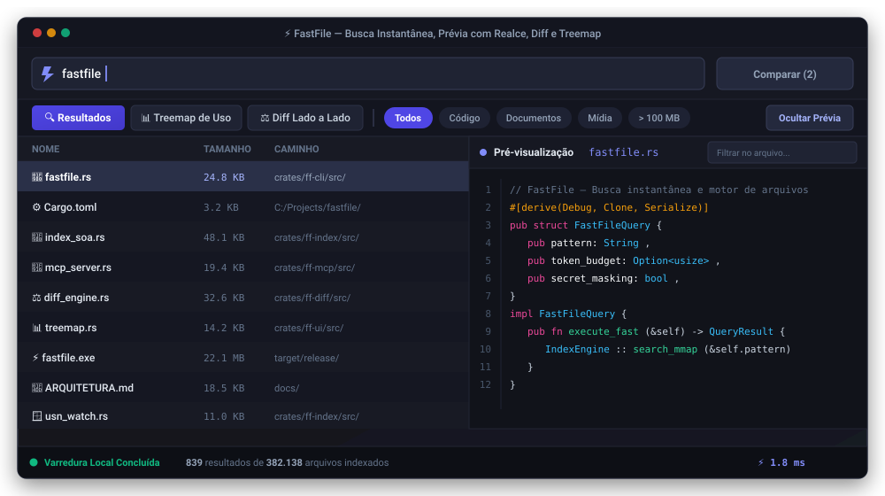
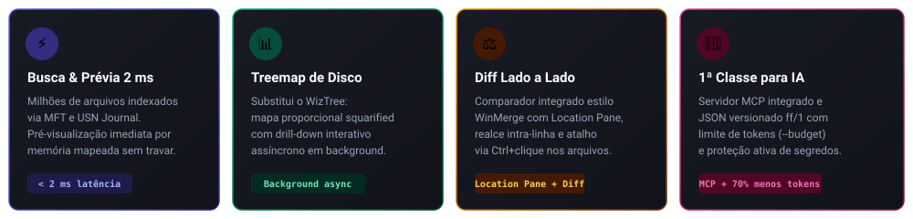

<div align="center">


<br/>

[](https://github.com/fabiomotta0311/fastfile/releases/tag/v0.1.0)
[](https://github.com/fabiomotta0311/fastfile)
[](docs/macos.md)
[](https://github.com/fabiomotta0311/fastfile)
[](docs/mcp.md)
[](README.md#privacidade)
[](LICENSE-MIT)

<br/>

### **O canivete suíço definitivo de arquivos: busca instantânea em 2 ms, visualizador de disco, prévia nativa e diff lado a lado.**
*Desenvolvido nativamente em Rust. Feito para humanos no dia a dia e desenhado como a interface de arquivos ideal para Agentes de IA.*

<br/>



<br/>



</div>

---

## 🎯 Por que o FastFile existe?

Quantos programas você precisa abrir ao longo de um dia de desenvolvimento para lidar com arquivos?

- 🔍 **Procurar arquivos num piscar de olhos?** Você abre o *Everything*.
- 📊 **Descobrir o que está lotando o seu SSD?** Você abre o *WizTree* ou *WinDirStat*.
- 👁️ **Achar trechos de código com prévia?** Você abre o *Agent Ransack* ou o VS Code.
- ⚖️ **Comparar dois arquivos rapidamente?** Você abre o *WinMerge* ou o *Meld*.
- 🤖 **E os seus Agentes de IA (Claude Code, Cursor, Antigravity, Hermes)?** Não usam nenhum deles: percorrem diretórios pelo terminal com `ls -la`, gastam milhares de tokens com pastas como `node_modules/` ou `target/` e correm o risco de ler arquivos com segredos (`.env`, chaves privadas).

> **O FastFile unifica tudo isso em um único aplicativo nativo em Rust:**
> Abre em milissegundos, consome quase zero de memória, tem interface gráfica fluida e moderna, atalhos no Windows Explorer e um **servidor MCP de primeira classe** para abastecer seus agentes autônomos com precisão cirúrgica.

---

## ⚡ Tabela Comparativa: 4 Ferramentas em 1

| Recurso | FastFile | Everything | WizTree | Agent Ransack | WinMerge |
| :--- | :---: | :---: | :---: | :---: | :---: |
| **Busca instantânea por nome (< 2 ms)** | ✅ *(MFT + USN)* | ✅ | ❌ | ❌ | ❌ |
| **Treemap visual proporcional de espaço** | ✅ *(Squarified)* | ❌ | ✅ | ❌ | ❌ |
| **Pré-visualização com Syntax Highlighting** | ✅ *(memmap2 + AST)* | Parcial *(só básica)* | ❌ | Parcial *(só texto)* | ❌ |
| **Diff Lado a Lado (com Location Pane)** | ✅ *(Ctrl+clique)* | ❌ | ❌ | ❌ | ✅ |
| **Busca em PDFs e DOCX nativa** | ✅ *(Extração direta)* | Parcial *(via IFilter)* | ❌ | ✅ | Parcial *(com plugin)* |
| **Servidor MCP integrado para Agentes** | ✅ *(Nativo)* | ❌ | ❌ | ❌ | ❌ |
| **JSON estruturado com limite de tokens (`--budget`)** | ✅ *(Envelope `ff/1`)* | ❌ | ❌ | ❌ | ❌ |
| **Proteção automática contra vazamento de segredos** | ✅ *(Nativa)* | ❌ | ❌ | ❌ | ❌ |
| **Nativo em Rust, multiplataforma (Win, Mac e Linux)** | ✅ | ❌ *(Só Win)* | ❌ *(Só Win)* | ❌ *(Só Win)* | ❌ *(Só Win)* |

---

## 🚀 Instalação Rápida

### No Windows (Recomendado)

Você pode instalar com um único comando pelo **Windows Package Manager (winget)**:

```powershell
winget install FabioMotta.FastFile
```

Ou baixar o pacote ZIP da [última release](https://github.com/fabiomotta0311/fastfile/releases/latest) e executar:

```powershell
.\scripts\install.ps1
```

> **Pronto!** O FastFile estará no seu `PATH`, registrado nos menus de contexto do Windows Explorer e acessível a qualquer momento:
> - Pressione `Win + R` e digite `fastfile` (ou `ff`)
> - Ou pressione o atalho global **`Ctrl + Alt + F`** (ou `Win + Shift + F`) para focar a janela instantaneamente.

### No macOS (Apple Silicon M1/M2/M3/M4 & Intel)

Você pode instalar com o **Homebrew** ou via script universal:

```bash
# Via Homebrew
brew install fabiomotta0311/fastfile/fastfile

# Ou clonando e executando o instalador automático
git clone https://github.com/fabiomotta0311/fastfile.git
cd fastfile && ./scripts/install.sh
```

> No Mac, use **`Cmd + F`** para buscar e **`Cmd + clique`** para comparar arquivos no Diff. Veja o [guia do macOS (`docs/macos.md`)](docs/macos.md).

### No Linux / Servidores / VPS (Headless & SSH)

O FastFile roda perfeitamente em modo CLI e servidor MCP sem interface gráfica no Linux:

```bash
# Compilação otimizada em release
cargo build --release --bin fastfile --bin ff

# Instalação no sistema
sudo cp target/release/fastfile target/release/ff /usr/local/bin/

# Consultas remotas ultrarrápidas via SSH por humanos ou agentes
ssh usuario@servidor fastfile du /var/log --top 10 --json
```

---

## 🤖 Feito para Agentes de IA (MCP & CLI)

O FastFile foi concebido desde a primeira linha de código para resolver o maior gargalo dos agentes de inteligência artificial modernos: **o consumo e desperdício de tokens de contexto**.

<div align="center">
  
  
</div>

### 1. Conectando como Servidor MCP
Basta adicionar a configuração ao seu cliente compatível (**Claude Code**, **Antigravity**, **Cursor**, **Hermes**, **Windsurf**):

```json
{
  "mcpServers": {
    "fastfile": {
      "command": "fastfile",
      "args": ["mcp"]
    }
  }
}
```

### 2. Recursos Pensados para LLMs
- **Orçamento de Tokens (`--budget`):** Limite a resposta ao tamanho exato que a LLM pode processar. Os arquivos mais relevantes vêm primeiro, com resumo compacto e ponteiro de paginação (`cursor`).
- **Filtro Inteligente de Ruído:** Pastas de compilação e dependências (`target/`, `node_modules/`, `.git/`, `dist/`) são ignoradas por padrão dentro de repositórios.
- **Proteção Ativa de Segredos:** Mascaramento automático em tempo real para arquivos `.env`, chaves privadas (`id_rsa`, `*.pem`), tokens JWT e dumps de rede (`*.har`).
- **Somente Leitura e Seguro:** O FastFile não apaga, move ou altera arquivos. É 100% seguro para ser operado por agentes autônomos.

---

## 💻 Recursos da Interface Gráfica

### 🔍 Busca Enquanto Digita & Prévia Instantânea
- Indexação direta no **NTFS Master File Table (MFT)** e escuta em tempo real pelo **USN Journal**.
- Filtros rápidos por pílulas: **Código**, **Documentos**, **Mídia**, **Compactados** ou **> 100 MB**.
- Pré-visualização com realce de sintaxe em dezenas de linguagens via `syntect` ou exibição em Hex Dump para arquivos binários, sem carregar o arquivo inteiro na memória RAM (utilizando `memmap2`).
- Busca e exportação da lista de resultados diretamente para formato **CSV**.

### 📊 Treemap de Uso de Disco (Visualizador de Espaço)
- Mapa térmico retangular proporcional (**Squarified Treemap**) para identificar pastas gigantes instantaneamente.
- Varredura em segundo plano (**background async**) com indicador de progresso para nunca travar a aplicação, mesmo em discos com milhões de arquivos.
- Drill-down completo: clique duplo para entrar numa pasta, botão para subir e atalhos rápidos (`C:\`, `D:\`, `Usuário`, `Downloads`).

### ⚖️ Diff Lado a Lado Estilo WinMerge
- Compare qualquer arquivo em segundos: selecione dois arquivos com `Ctrl + clique` ou envie pelo menu de contexto do Windows Explorer.
- **Location Pane lateral:** Uma barra de navegação visual que mapeia todas as inserções, remoções e alterações do arquivo completo.
- **Realce intra-linha:** Veja exatamente quais caracteres ou palavras mudaram dentro de uma linha modificada.

---

## 🛠️ CLI Rápida para o Terminal (`ff`)

Para quem prefere a linha de comando no terminal ou scripts de automação:

```powershell
# Buscar arquivos por padrão, extensão ou regex
ff find "*.rs"
ff find "report" --type doc

# Diagnóstico de espaço ocupado (estilo 'du' ultra veloz)
ff du C:\Projetos --top 10

# Busca de conteúdo dentro de arquivos (grep de alta performance)
ff grep "fn parse_mft" --type rust

# Encontrar onde uma função, classe ou struct está definida via AST
ff sym AuthenticatedUser

# Visão panorâmica e compacta da estrutura de um repositório
ff map . --budget 2000

# Detecção instantânea de arquivos duplicados por tamanho e hash
ff dupes C:\Downloads
```

---

## 📊 Benchmarks de Desempenho

Resultados medidos comparando agentes autônomos executando tarefas reais de engenharia com e sem o FastFile:

| Tarefa do Agente | Sem FastFile | Com FastFile | Ganho de Produtividade |
| :--- | :---: | :---: | :---: |
| **Diagnóstico de espaço em disco** | 18,4 s *(4.850 tokens, 5 chamadas)* | **5,2 s** *(1.410 tokens, 1 chamada)* | **3,5× mais rápido · -70% tokens** |
| **Localizar arquivos de configuração** | 14,5 s *(4.200 tokens, 4 chamadas)* | **4,9 s** *(1.300 tokens, 1 chamada)* | **3,0× mais rápido · -69% tokens** |
| **Localizar definição de símbolos (AST)** | 13,8 s *(3.950 tokens, 4 chamadas)* | **4,6 s** *(1.250 tokens, 1 chamada)* | **3,0× mais rápido · -68% tokens** |
| **Grep em repositório extenso** | 12,1 s *(3.640 tokens, 4 chamadas)* | **4,4 s** *(1.320 tokens, 1 chamada)* | **2,8× mais rápido · -64% tokens** |

> *Metodologia detalhada e relatórios reproduzíveis disponíveis em [`bench/agentes/RESULTADOS.md`](bench/agentes/RESULTADOS.md).*

---

## 🔒 Privacidade em Primeiro Lugar

- **Zero Telemetria:** O FastFile não possui telemetria, não realiza chamadas para a internet e não coleta dados analíticos.
- **O índice é 100% seu:** O índice de arquivos é estritamente local e armazenado com permissões restritas ao usuário corrente.
- **Menor Privilégio:** Apenas o indexador de baixo nível opcional utiliza privilégios elevados para leitura da MFT; a interface gráfica, as prévias e os diffs rodam como usuário comum desprivilegiado.

---

## 📚 Documentação Técnica

- 🏛️ [**Arquitetura do Sistema (`docs/ARQUITETURA.md`)**](docs/ARQUITETURA.md) — Detalhes da MFT, USN Journal, SoA e decisões de design.
- 🍏 [**Guia do macOS (`docs/macos.md`)**](docs/macos.md) — Instalação no Mac (Apple Silicon & Intel), Homebrew e Launchd.
- 🤖 [**Guia do Servidor MCP (`docs/mcp.md`)**](docs/mcp.md) — Configuração passo a passo para Claude Code, Antigravity e Cursor.
- 🌐 [**Uso Remoto via SSH (`docs/remoto.md`)**](docs/remoto.md) — Guia de execução em servidores Linux headless.
- 📦 [**Distribuição e Empacotamento (`docs/distribuicao-lojas.md`)**](docs/distribuicao-lojas.md) — WinGet, Scoop, AUR e Flatpak.

---

## 📄 Licença

Distribuído sob licença dupla **MIT** ou **Apache-2.0**. Consulte os arquivos de licença para maiores detalhes.
